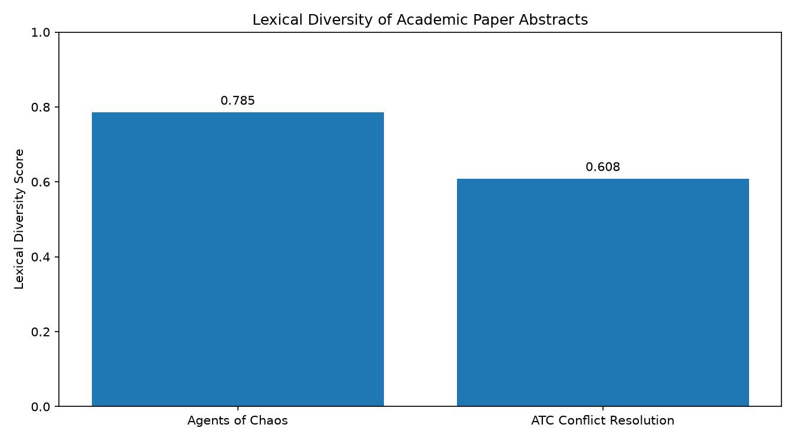

# nlp-05-web-documents-custom

[](pyproject.toml)
[](https://github.com/denisecase/nlp-05-web-documents/actions/workflows/ci-python-zensical.yml)
[](https://denisecase.github.io/nlp-05-web-documents/)

[](https://docs.astral.sh/uv/)
[](https://docs.astral.sh/ty/)
[](https://zensical.org/)
[](LICENSE)

> Acquire, validate, and transform HTML web documents using Python.

## Custom Project Processes and Results

Author: Kevin Hennelly

Date: 2026 November

Fifth project in the Web Mining and Applied NLP course.

This project introduces web document acquisition
and structured information extraction from HTML.

The goal is to retrieve a web page,
validate its document structure,
extract meaningful text and metadata,
and save the results for analysis.

The project extends the EVTL pipeline approach
introduced in Module 4 to work with HTML documents
rather than JSON API responses.

The project is configured in
[pyproject.toml](pyproject.toml).

## Technical Modification: Abstract Lexical Diversity

### Purpose

For this experiment, I added a new field called `abstract_lexical_diversity` to the Transform stage of the EVTL pipeline. This measures vocabulary variety by calculating the proportion of unique words in the abstract compared to the total number of words.

### Prediction

I predicted that the program would calculate a lexical diversity score between 0 and 1 and add it as a new column in the DataFrame and CSV file. A score closer to 1 indicates more unique words, while a score closer to 0 indicates more repetition.

### Modification

I created a custom copy of `stage03_transform.py` named `stage03_transform_custom.py` and updated the custom pipeline to use it.

The new calculation converts words to lowercase, removes common surrounding punctuation, and divides the number of unique words by the total number of words. The result is rounded to three decimal places.

The original Python files were preserved.

### Results

The modified pipeline ran successfully using the academic paper *Agents of Chaos* from arXiv.

- Abstract word count: 177
- Lexical diversity score: 0.785
- Original DataFrame: 1 row and 8 columns
- Modified DataFrame: 1 row and 9 columns
- Output file: `data/processed/case_processed.csv`

The lexical diversity score of 0.785 indicates that approximately 78.5% of the words counted in the abstract were unique.

### Conclusion

The experiment worked as expected. I learned how to add a new derived field to an existing data processing pipeline while preserving the original example. Lexical diversity provides another way to analyze text and could be useful when comparing vocabulary across different academic papers.

## Custom Application: Air Traffic Conflict Resolution Research

### Project Overview

For my custom application, I used the EVTL pipeline to extract and analyze information from an academic paper related to air traffic control conflict resolution.

The goal was to demonstrate how web scraping and text analysis techniques can be applied to aviation research, while also showing comparison in lexical diversity between two different academic papers more broadly.

### Data Source

**Paper:** Data-driven prediction of Air Traffic Controllers reactions to resolving conflicts

**Authors:** Alevizos Bastas and George A. Vouros

**Source:** https://arxiv.org/abs/2205.09539

The paper examines how data-driven methods can help predict air traffic controller actions when resolving potential aircraft conflicts.

### Methods and Tools

I used Python, Requests, BeautifulSoup, and Pandas to extract, validate, transform, and organize information from the paper's arXiv page.

The project follows the Extract, Validate, Transform, and Load (EVTL) pipeline:

1. **Extract:** Retrieve the HTML document from arXiv.
2. **Validate:** Check the HTML structure and required elements.
3. **Transform:** Extract metadata and calculate text analysis metrics.
4. **Load:** Save the structured data to a CSV file.

I also used Matplotlib to create a visualization comparing lexical diversity scores.

### Customization

I created a separate `config_custom.py` file to specify the new paper and output filenames.

I also used `stage03_transform_custom.py` to calculate lexical diversity and `pipeline_web_html_custom.py` to execute the customized pipeline.

The original example files were preserved.

### Results

The customized pipeline executed successfully and produced the following results:

- Authors: 2
- Abstract word count: 148
- Lexical diversity score: 0.608
- DataFrame: 1 row and 9 columns
- Output file: `data/processed/atc_conflict_processed.csv`

### Lexical Diversity Comparison



The *Agents of Chaos* abstract had a lexical diversity score of 0.785, compared with 0.608 for the air traffic conflict resolution paper.

This means approximately 78.5% of the analyzed words in the first abstract were unique, compared with 60.8% in the aviation paper.

The difference suggests that the first abstract contained a greater proportion of unique vocabulary; however, differences in document length and subject matter may also influence the scores.

### Interpretation and Limitations

The project demonstrates that the same EVTL pipeline can process academic papers on different subjects while maintaining a consistent data structure.

One notable limitation is that the analysis only compares two abstracts. Lexical diversity alone does not determine the complexity or quality of academic writing. Additional papers would provide a better basis for identifying broader trends.

### Conclusion

This project allowed me to apply web scraping, HTML parsing, data validation, and text analysis to an aviation-related research topic.

The customized pipeline successfully extracted the paper's metadata, calculated lexical diversity, and generated a CSV file for further analysis.

In the future, I could expand this project to compare a larger collection of aviation research papers and identify patterns in the terminology used across different subjects.

## General Project Overview

## Data

The example retrieves an academic paper's abstract page
from [arXiv](https://arxiv.org/abs/2602.20021).

The source document contains information such as:

- Paper title.
- Authors.
- Abstract.
- Subject categories.
- Submission information.
- arXiv identifier.

The pipeline preserves the original HTML
and produces a structured CSV dataset
containing extracted metadata.

## Approach

The project uses a modular Python pipeline
to acquire, validate, transform, and save HTML data.

The pipeline has four stages:

- **Extract** - retrieve HTML from a web page.
- **Validate** - verify that required HTML elements exist.
- **Transform** - extract text and metadata into a structured dataset.
- **Load** - save the processed data to a CSV file.

The example uses Requests for HTTP acquisition,
BeautifulSoup for HTML parsing,
and Pandas for tabular data processing.

The Transform stage also calculates
derived fields such as abstract word count
and number of authors.

Explore these important project components:

- [pyproject.toml](pyproject.toml) - project identity, dependencies, and tool configuration.
- [src/nlp/pipeline_web_html.py](src/nlp/pipeline_web_html.py) - main EVTL pipeline orchestrator.
- [src/nlp/config.py](src/nlp/config.py) - example web page and path configuration.
- [src/nlp/stage01_extract.py](src/nlp/stage01_extract.py) - retrieve HTML.
- [src/nlp/stage02_validate.py](src/nlp/stage02_validate.py) - validate HTML structure.
- [src/nlp/stage03_transform.py](src/nlp/stage03_transform.py) - extract metadata and build a DataFrame.
- [src/nlp/stage04_load.py](src/nlp/stage04_load.py) - save processed results.
- [tests/](tests/) - automated tests.
- [.github/workflows/](.github/workflows/) - automated testing and documentation deployment.
- [docs/](docs/) - project documentation.
- [zensical.toml](zensical.toml) - documentation configuration.

The goal is to understand how information
is extracted from semi-structured web documents
and transformed into analysis-ready data.

## Run the Project

Follow the [Professional Python Workflow Guide](https://denisecase.github.io/pro-analytics-02/)
to set up your machine and project environment.

From a VS Code terminal in the project root:

```shell
uv run python -m nlp.pipeline_web_html
```

## Results

The pipeline retrieves an HTML document,
validates its structure,
extracts bibliographic information,
and writes the results to a CSV file.

The resulting dataset includes text and metadata
along with derived measures
such as abstract word count and author count.

Successful execution produces:

```shell
========================
Pipeline executed successfully!
========================
```

The following files are created:

- `project.log` - pipeline execution log.
- `data/raw/case_raw.html` - original HTML document.
- `data/processed/case_processed.csv` - extracted and transformed data.

These artifacts provide evidence of successful
HTML acquisition, validation, transformation, and persistence.

## Verification

Run the automated tests:

```shell
uv run python -m pytest
```

## Project Documentation

The [hosted documentation site](https://KHenn22.github.io/nlp-05-web-documents-custom/)
is published using Zensical and GitHub Pages.

The documentation site is used to present the project report,
covering such sections as data, methods, results, visualizations,
interpretation, and conclusions.

## CI/CD and GitHub Actions

This project includes continuous integration and continuous deployment (CI/CD)
to check project files and publish the docs.

GitHub Actions include:

- [CI: Python and Documentation Checks](https://github.com/KHenn22/nlp-05-web-documents-custom/actions/workflows/ci-python-zensical.yml)
- [CD: Documentation Deployment](https://github.com/KHenn22/nlp-05-web-documents-custom/actions/workflows/deploy-zensical.yml)

## Developer Reference

Follow the
[Professional Python Workflow Guide](https://denisecase.github.io/pro-analytics-02/)
for **detailed instructions and troubleshooting**.

### Initialize and Update the Python Environment

With the project open in VS Code, open a VS Code terminal.
Paste each command and hit Enter or Return after to run it.

```shell
uvx pup-clean --delete
uv self update
uv python pin 3.14
uv python install
uv lock --upgrade
uv sync
uv audit
```

### Set Up and Run Git Hooks

Set up and run the git hooks to perform
basic checks automatically before
any changes get pushed to GitHub.

In the VS Code terminal,
paste each command and hit Enter or Return after to run it.

```shell
uvx prek install --force
uvx prek update --freeze --cooldown-days 7

git add -A
uvx prek run --all-files
# repeat if changes were made
uvx prek run --all-files
```

### Run Common Chores

Run linters, formatters, type checks, tests, and
build the documentation.

```shell
uv run ruff check . --fix
uv run ruff format .

uv run ty check
uv run python -m pytest
uv run python -m zensical build
```

### Git add-commit-push to GitHub

After making useful changes, save your work to GitHub.

```shell
git add -A
git commit -m "describe your changes in quotes"
git push -u origin main
```

## Developer Notes

- Use the **UP ARROW** and **DOWN ARROW** in the terminal to scroll through past commands.
- Use `CTRL+f` to find (and replace) text within a file.

## Developer Tools

This project uses professional Python tools to support development,
testing, documentation, and code quality.

- [uv](https://docs.astral.sh/uv/) - Python environments and dependencies.
- [Ruff](https://docs.astral.sh/ruff/) - Python linting and formatting, configured in [.ruff.toml](.ruff.toml).
- [ty](https://docs.astral.sh/ty/) - Python type checking.
- [pytest](https://docs.pytest.org/) - automated Python testing, configured in [.pytest.toml](.pytest.toml).
- [prek](https://prek.j178.dev/) - Git hooks and automated checks, configured in [prek.toml](prek.toml).
- [Zensical](https://zensical.org/) - project documentation, configured in [zensical.toml](zensical.toml).

## Links

- [Hosted Documentation](https://denisecase.github.io/nlp-05-web-documents/)
- [Professional Python Workflow Guide](https://denisecase.github.io/pro-analytics-02/)
- [Citation](CITATION.cff)
- [License](LICENSE)
